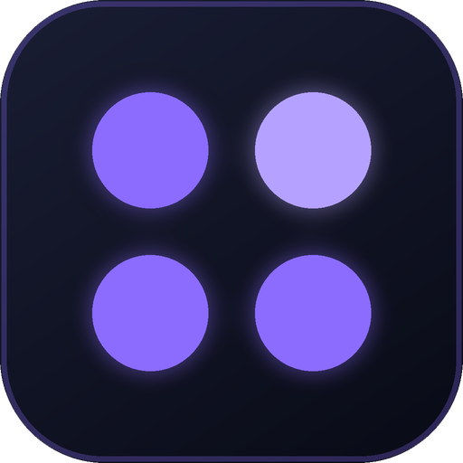
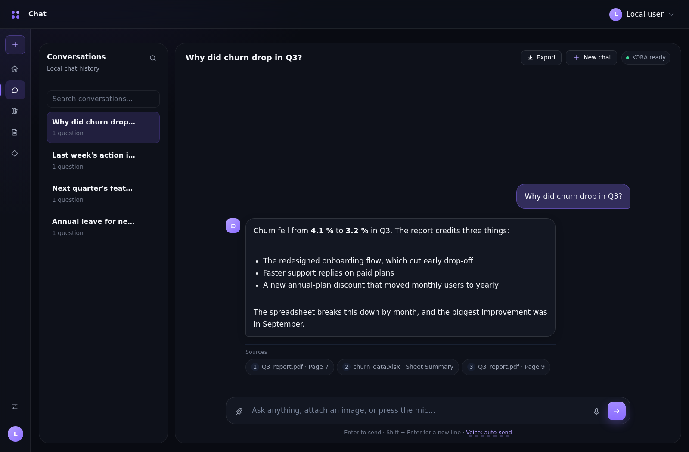
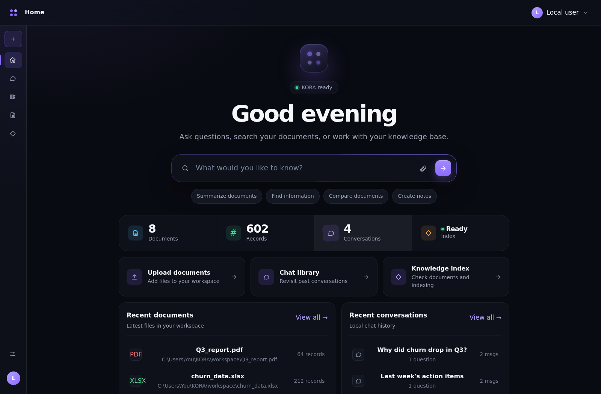
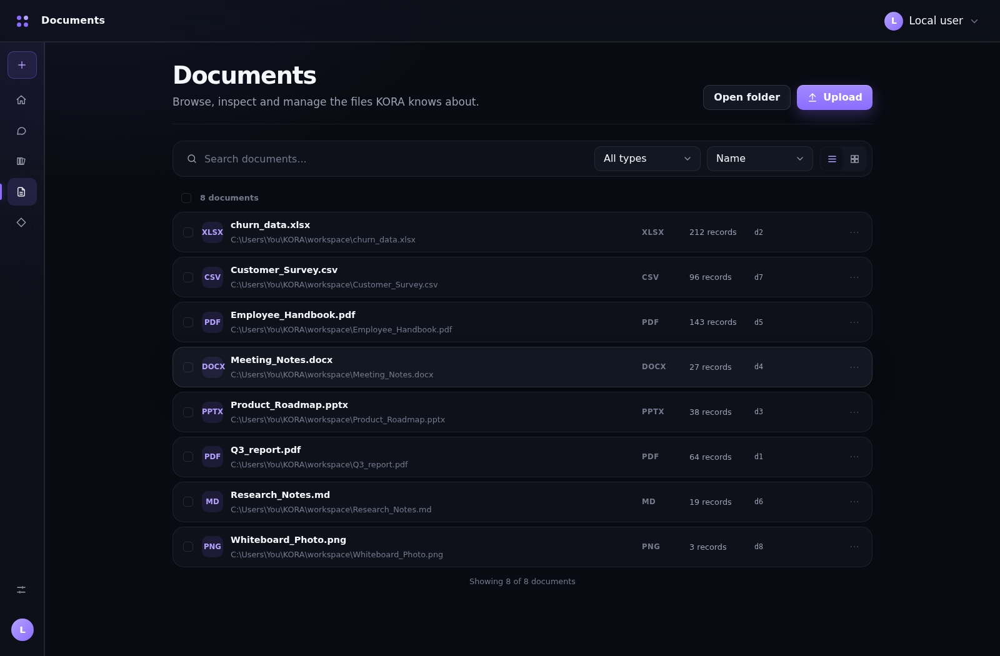
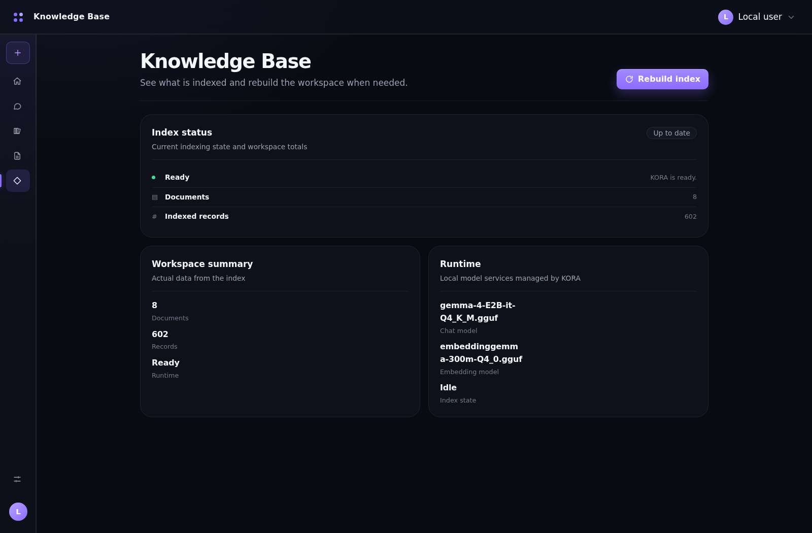
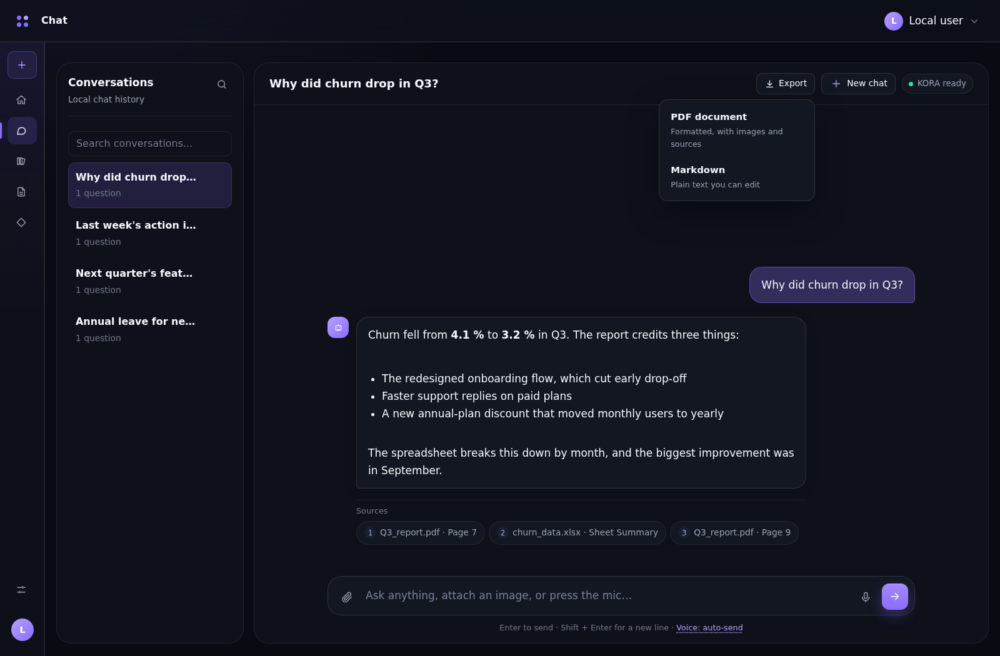
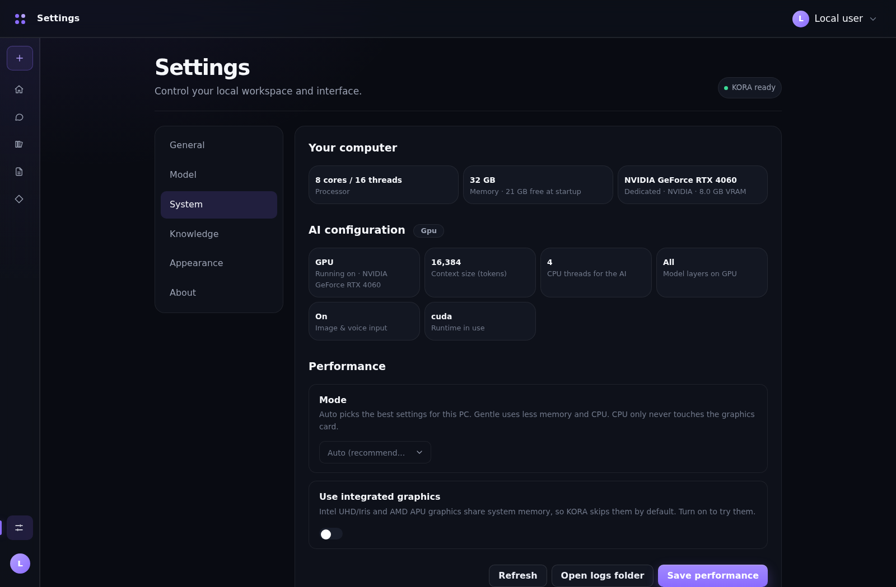
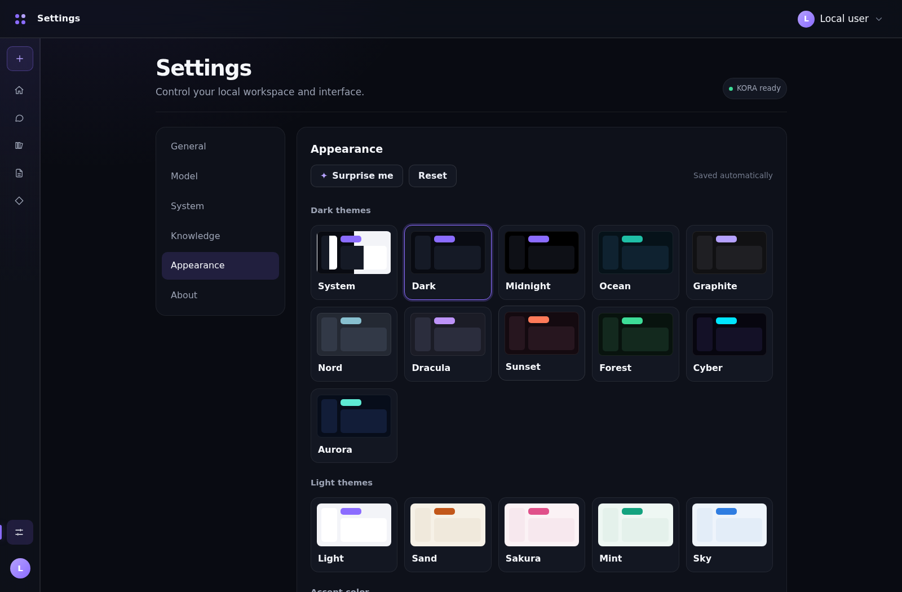

<div align="center">



# KORA

**Knowledge Oriented Response Assistant**

Ask questions about **your own files**. Everything runs on your computer — no internet, no account, no cloud.




</div>

---

## What is KORA?

KORA is a private AI assistant for Windows. You add your documents (PDF, Word, PowerPoint, Excel, text, images), then you simply **ask a question**. KORA reads your files and answers, and it **shows you which file and page the answer came from**.

Your files and chats **never leave your computer**.

---

## Screenshots

| | |
|---|---|
| <br>**Home** | <br>**Documents** |
| <br>**Knowledge Base** | <br>**Export chats to PDF / Markdown** |
| <br>**It tunes itself to your PC** | <br>**Themes & colours** |

---

## ✅ What you need (read this first)

> [!IMPORTANT]
> Make sure you have **all** of these. Missing one is the #1 reason KORA does not work.

| | What | Notes |
|---|---|---|
| 1 | **Windows 10 or 11 (64-bit)** | KORA is Windows only |
| 2 | **8 GB RAM** (4 GB works but is slow) | 16 GB is best |
| 3 | **About 6 GB free disk space** | For the AI files |
| 4 | **Tesseract OCR** ⚠️ **REQUIRED** | Lets KORA read scanned PDFs and images. [**Download here**](https://github.com/UB-Mannheim/tesseract/wiki) |
| 5 | **The AI runtime** (llama.cpp) | Step 3 below |
| 6 | **The AI model files** | Step 4 below |
| 7 | **Internet — only for downloading** | After setup KORA works fully offline |

A graphics card (GPU) is **not** required. If you have one, KORA uses it automatically.

---

## 🚀 Setup — 5 easy steps

### Step 1 — Download KORA

1. Open the **[Releases](../../releases)** page of this repository.
2. Download **`KORA.zip`**.
3. **Right-click → Extract All** to a simple folder, for example `C:\KORA`.

> [!WARNING]
> Do **not** put KORA inside `C:\Program Files`, and do not run it from inside the zip. Extract it first, then open it from a normal folder.

You will see `KORA.exe` and a few folders (`models`, `runtime`, `workspace`, …).

---

### Step 2 — Install Tesseract OCR ⚠️ REQUIRED

> [!IMPORTANT]
> Tesseract is **required**. Without it KORA cannot read scanned PDFs or pictures of text.

1. Go to **<https://github.com/UB-Mannheim/tesseract/wiki>**
2. Download the **Windows installer** (the latest `tesseract-ocr-w64-setup….exe`).
3. Run it and click **Next** through the installer.
4. **Keep the default install folder:** `C:\Program Files\Tesseract-OCR`
   KORA finds it there automatically.

Done. If KORA was already open, close it and open it again.

---

### Step 3 — Download the AI runtime (llama.cpp)

This is the small program that runs the AI.

1. Open **<https://github.com/ggml-org/llama.cpp/releases/latest>**
2. Scroll down to **Assets** and download the file whose name looks like:

   **`llama-bXXXX-bin-win-vulkan-x64.zip`**

   *(`XXXX` is just a version number — it changes often. Any number is fine.)*
3. Extract it, and copy **everything inside** into this folder:

   **`KORA\runtime\vulkan\`**

> [!TIP]
> **Not sure which one to pick? Choose Vulkan.** It works on NVIDIA, AMD and Intel graphics.
> **No graphics card or a very old PC?** Download `llama-bXXXX-bin-win-cpu-x64.zip` instead and put it in `KORA\runtime\cpu\`.

> [!IMPORTANT]
> The file **`llama-server.exe`** must be **directly inside** `runtime\vulkan\` — not inside another folder.

---

### Step 4 — Download the AI models

Put these files in the **`KORA\models`** folder.

| # | File | Needed? | Size | Download |
|---|---|---|---|---|
| 1 | **Chat model** | ✅ Required | ≈ 3 GB | [Download](https://huggingface.co/unsloth/gemma-4-E2B-it-GGUF/resolve/main/gemma-4-E2B-it-Q4_K_M.gguf) |
| 2 | **Embedding model** | ✅ Required | ≈ 0.25 GB | [Open page & download](https://huggingface.co/ggml-org/embeddinggemma-300M-qat-q4_0-GGUF) |
| 3 | **Image & voice add-on** | Optional | ≈ 0.9 GB | [Download](https://huggingface.co/unsloth/gemma-4-E2B-it-GGUF/resolve/main/mmproj-F16.gguf) |

> [!IMPORTANT]
> **The file names must be exactly:**
> ```
> gemma-4-E2B-it-Q4_K_M.gguf
> embeddinggemma-300m-Q4_0.gguf
> mmproj-F16.gguf
> ```
> The embedding file is often downloaded with a slightly different name (for example `embeddinggemma-300M-qat-Q4_0.gguf`).
> **Right-click it → Rename** to `embeddinggemma-300m-Q4_0.gguf`.

Item 3 is only needed if you want to attach pictures or speak to KORA. You can skip it.

---

### Step 5 — Check your folders, then start

Your KORA folder should look like this:

```
KORA\
├─ KORA.exe
├─ runtime\
│  └─ vulkan\
│     └─ llama-server.exe  (+ other .dll files)
├─ models\
│  ├─ gemma-4-E2B-it-Q4_K_M.gguf
│  ├─ embeddinggemma-300m-Q4_0.gguf
│  └─ mmproj-F16.gguf        (optional)
└─ workspace\                (your documents go here)
```

Now **double-click `KORA.exe`**.

A small window opens straight away while the AI loads. **The first start can take 1–2 minutes** — this is normal. When KORA is ready, the main window appears.

---

## 💬 Using KORA

1. **Add your files** — go to **Documents** and upload them. KORA reads them automatically in the background.
2. **Ask a question** — go to **Chat** and type. KORA shows the **sources** under every answer.
3. **Find old chats** — open **Library**. You can export any chat as **PDF** or **Markdown**.
4. **Make it yours** — **Settings → Appearance** has themes and colours.

**Supported files:** PDF, Word (`.docx`), PowerPoint (`.pptx`), Excel (`.xlsx`, `.xls`), `.csv`, `.json`, `.txt`, `.md`, and pictures (`.png .jpg .jpeg .bmp .tiff .webp`).

---

## 🛠️ Something not working?

| Problem | Fix |
|---|---|
| **"Required model not found"** | Check the file names in the `models` folder. They must match [Step 4](#step-4--download-the-ai-models) exactly. |
| **"llama-server runtime not found"** | `llama-server.exe` must be directly inside `runtime\vulkan\` (not in a sub-folder). See [Step 3](#step-3--download-the-ai-runtime-llamacpp). |
| **Scanned PDFs or images give no text** | Install **Tesseract OCR** ([Step 2](#step-2--install-tesseract-ocr--required)) in the default folder, then restart KORA. |
| **Stuck on the loading screen** | Wait 2 minutes on the first start. If it stays stuck, see the logs below. |
| **Very slow answers** | Close other heavy programs. Open **Settings → System** and choose **Gentle** or **CPU only**, then restart KORA. |
| **Window does not open** | Install the [WebView2 runtime](https://developer.microsoft.com/en-us/microsoft-edge/webview2/) (already included on most Windows 10/11 PCs). |
| **Image / microphone buttons are greyed out** | You skipped the optional `mmproj-F16.gguf` file. Add it to `models` and restart. |
| **"Port already in use"** | KORA is already open somewhere. Close it and try again. |
| **Antivirus warning on `KORA.exe`** | This sometimes happens with apps made in Python. It is a false alarm — allow the file. |

**Still stuck?** Open the **`logs`** folder inside KORA (or **Settings → System → Open logs folder**) and look at **`kora.log`**. When asking for help, attach `kora.log`.

---

## 🔒 Privacy

KORA runs entirely on your computer. It only talks to itself (`127.0.0.1`). Your documents, chats and AI models never leave your PC. The only time it uses the internet is when **you** download the setup files.

---

## Credits

KORA is built with these open-source projects:
[llama.cpp](https://github.com/ggml-org/llama.cpp) ·
[Gemma 4](https://huggingface.co/google/gemma-4-E2B-it) and [EmbeddingGemma](https://huggingface.co/google/embeddinggemma-300m) by Google ·
[Tesseract](https://github.com/tesseract-ocr/tesseract) ·
[pywebview](https://pywebview.flowrl.com/) ·
[Flask](https://flask.palletsprojects.com/)

Each AI model has its own license. Please read it on its Hugging Face page before using it commercially.

<div align="center">

Made with ❤️ to keep your knowledge on your own machine.

</div>
