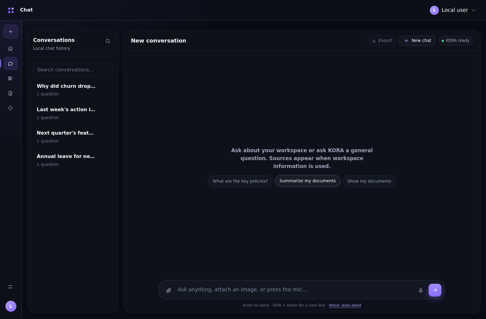
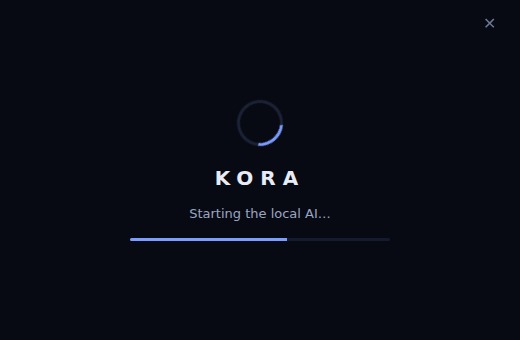
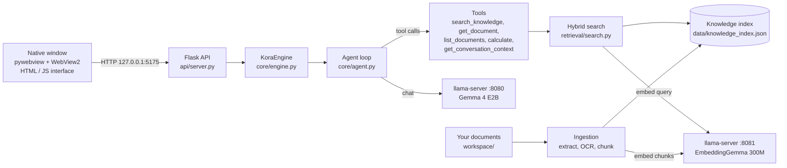

<div align="center">


# KORA

**Knowledge Oriented Response Assistant**

A fully local, private AI assistant for Windows that answers questions about *your own files*.
Chat, search your documents, read images and listen to voice — all on your computer, no cloud, no accounts, no API keys.




</div>

---

## Table of contents

1. [What is KORA?](#what-is-kora)
2. [Screenshots](#screenshots)
3. [Features](#features)
4. [How it works](#how-it-works)
5. [Automatic hardware tuning](#automatic-hardware-tuning)
6. [Requirements](#requirements)
7. [Installation](#installation)
   - [Step 1 – Get KORA](#step-1--get-kora)
   - [Step 2 – Download the AI runtime (llama.cpp) for your GPU](#step-2--download-the-ai-runtime-llamacpp-for-your-gpu)
   - [Step 3 – Download the models](#step-3--download-the-models)
   - [Step 4 – Check your folder layout](#step-4--check-your-folder-layout)
   - [Step 5 – (Optional) OCR for scanned documents](#step-5--optional-ocr-for-scanned-documents)
   - [Step 6 – Launch](#step-6--launch)
8. [GPU guide: NVIDIA, AMD, Intel, or none](#gpu-guide-nvidia-amd-intel-or-none)
9. [Using KORA](#using-kora)
10. [Configuration](#configuration)
11. [Logs & troubleshooting](#logs--troubleshooting)
12. [Building the .exe yourself](#building-the-exe-yourself)
13. [Project structure](#project-structure)
14. [Privacy](#privacy)
15. [Credits & licenses](#credits--licenses)

---

## What is KORA?

KORA is a desktop app that runs a small but capable language model (**Gemma 4 E2B**) and an embedding model (**EmbeddingGemma 300M**) locally through [llama.cpp](https://github.com/ggml-org/llama.cpp). You drop your documents into KORA, it indexes them, and then you can simply *ask* — KORA searches your files, reads the relevant parts, and answers with the sources shown underneath.

It is built to be **universal**: on startup it detects your CPU, RAM and GPU (NVIDIA, AMD or Intel) and configures the AI so it runs well on a gaming PC *and* doesn't choke a low-end laptop.

> Everything — your files, the index, your chat history, the models — stays on your computer.

---

## Screenshots

> The images below are placeholders until you add real ones. See [`docs/screenshots/README.md`](docs/screenshots/README.md) for the list of file names.

| | |
|---|---|
|  <br> **Instant startup splash** |  <br> **Home** |
|  <br> **Chat** |  <br> **Answers with sources** |
|  <br> **Documents** |  <br> **Knowledge Base** |
|  <br> **Settings → System (PC specs & AI config)** |  <br> **Appearance** |
|  <br> **Library & export** | |

---

## Features

- **Chat with your documents** – ask in plain language; KORA decides when to search your files and shows the sources it used.
- **Many file types** – PDF, Word (`.docx`), PowerPoint (`.pptx`), Excel (`.xlsx`, `.xls`), `.csv`, `.json`, `.txt`, `.md`, and images (`.png .jpg .jpeg .bmp .tiff .webp`).
- **OCR** – scanned PDFs and images are read with Tesseract (optional install).
- **Image & voice input** – attach a picture or record a voice message (needs the multimodal projector file, see [models](#step-3--download-the-models)).
- **Streaming answers** and a built-in **calculator** tool.
- **Library** – all previous conversations, searchable, with **export to PDF or Markdown**.
- **Instant startup** – a splash window opens the moment you double-click; no terminal windows.
- **Automatic hardware tuning** – detects CPU / RAM / GPU and picks the context size, GPU offload and threads for you. Manual override in **Settings → System**.
- **NVIDIA, AMD and Intel GPU support** (CUDA / Vulkan / SYCL builds) with automatic fallback to CPU if a GPU backend fails.
- **Logs folder** – everything that goes wrong is written to `logs/` so you can diagnose it.
- **Customisable UI** – dark/light themes, accent colours, glass effect, density, fonts, command palette (`Ctrl + K`).
- **Frameless native window** (pywebview + Microsoft WebView2) with your settings remembered between launches.

---

## How it works

### Architecture



### Startup sequence

1. `KORA.exe` opens a **splash window immediately** (before anything heavy is loaded).
2. KORA **detects your hardware** and chooses AI settings (logged to `logs/hardware.json`).
3. The engine and the local web server start.
4. The two **llama-server** processes (chat + embeddings) are launched **hidden** (no terminal windows) at below-normal priority, using the best runtime folder for your GPU. If one fails, KORA tries the next option and finally the CPU.
5. The splash hands over to the app, whose boot screen shows live progress until the models respond.
6. Your workspace is indexed in the background.

### How an answer is made

1. **Understand** – the local model reads your question and decides what it needs.
2. **Use tools** – it can search your documents, open a document, list files, look at the conversation, or calculate (up to 8 steps per question).
3. **Write the answer** – the model turns the results into a normal response, streamed to the screen.
4. **Show sources** – if indexed records were used, the file / page / sheet / slide is shown under the answer.

### How search works

Documents are split into records (with page / sheet / slide / section metadata) and embedded by EmbeddingGemma. A query is scored with a **hybrid** ranking: **75 % semantic similarity** (cosine of embeddings) + **25 % keyword overlap**. The top results (default 8) are handed to the model.

---

## Automatic hardware tuning

At startup KORA measures your machine and builds a profile. You can see it in **Settings → System**.

| Detected | What KORA does |
|---|---|
| **Dedicated GPU with enough memory** (NVIDIA / AMD / Intel Arc) | Puts the whole model on the GPU, picks the largest context that fits (up to 16 384 tokens), uses few CPU threads |
| **Dedicated GPU with limited memory** (e.g. 4 GB laptop card) | Splits the model: part on the GPU, rest on the CPU, 4 096 context |
| **GPU too small** (≈ 2 GB or less) | Uses the CPU instead |
| **Integrated graphics only** (Intel UHD/Iris, AMD APU) | Runs on the CPU (safer with shared memory). Can be switched on in Settings |
| **No GPU / low-end laptop** | CPU mode: leaves a couple of cores and a share of RAM free for Windows, smaller context (up to 8 192), turns off image/voice if RAM is very low |

Other safety measures: the AI runs at **below-normal priority** so your PC stays responsive, slow machines get a **longer model-loading timeout**, and if a GPU backend crashes on start KORA **falls back automatically** (GPU build → next build → CPU).

In **Settings → System** you can choose **Auto (recommended)**, **Gentle** (lower resources) or **CPU only**, and optionally allow integrated graphics. Changes apply the next time KORA starts.

---

## Requirements

| | Minimum | Recommended |
|---|---|---|
| **OS** | Windows 10 (64-bit) | Windows 11 |
| **RAM** | 4 GB (works, but slow) | 16 GB |
| **Disk** | ~6 GB free (app + models) | SSD |
| **CPU** | Any 64-bit, 2+ cores | 6+ cores |
| **GPU** | Not required | NVIDIA / AMD / Intel Arc with 6 GB+ VRAM |

Software:

- **Microsoft WebView2 runtime** – already included in Windows 10/11. If the window won't open on an older PC, install it: <https://developer.microsoft.com/en-us/microsoft-edge/webview2/>
- **Up-to-date graphics driver** if you want GPU acceleration (Vulkan support comes with the normal NVIDIA / AMD / Intel drivers).
- **Python 3.11 or newer** – only if you run KORA from source or build the exe yourself: <https://www.python.org/downloads/> (tick *Add python.exe to PATH*).
- **Tesseract OCR** – optional, only for scanned PDFs / images.

---

## Installation

You need three things next to the app: **the app itself**, **the llama.cpp runtime** (the program that runs the models), and **the model files**. The runtime and models are large, so they are *not* stored in this repository.

### Step 1 – Get KORA

Pick **one**:

<details open>
<summary><b>A) Pre-built app (easiest)</b></summary>

1. Go to the **[Releases](../../releases)** page of this repository and download **`KORA.zip`**.
2. Extract it anywhere you like (for example `C:\KORA`). Avoid folders that need admin rights, such as `C:\Program Files`.
3. You will see `KORA.exe` plus the folders `models`, `runtime`, `data`, `logs`, `workspace`, `web`. Continue with Step 2.

</details>

<details>
<summary><b>B) Run from source</b></summary>

```bat
git clone https://github.com/YOUR-USERNAME/KORA.git
cd KORA
setup_kora.bat
```

`setup_kora.bat` creates a virtual environment (`.venv`) and installs everything in `requirements.txt`. Then do Steps 2 – 5, and start the app with `run_kora.bat`.

</details>

<details>
<summary><b>C) Build the .exe yourself</b></summary>

See [Building the .exe yourself](#building-the-exe-yourself).

</details>

### Step 2 – Download the AI runtime (llama.cpp) for your GPU

KORA uses **llama-server** from llama.cpp. Download the Windows build that matches your hardware from the official releases page:

**<https://github.com/ggml-org/llama.cpp/releases/latest>**

Scroll to **Assets** and pick by your GPU (the number after `b` in the file name is just the build number and changes often):

| Your hardware | Download this asset | Extract into |
|---|---|---|
| **Any GPU – simplest, works on NVIDIA, AMD and Intel** | `llama-bXXXX-bin-win-vulkan-x64.zip` | `runtime\vulkan\` |
| **NVIDIA (fastest)** | `llama-bXXXX-bin-win-cuda-12.4-x64.zip` **and** `cudart-llama-bin-win-cuda-12.4-x64.zip` (extract **both** into the same folder). Newer cards / drivers can use the `cuda-13.x` pair instead | `runtime\cuda\` |
| **Intel Arc (optional alternative to Vulkan)** | `llama-bXXXX-bin-win-sycl-x64.zip` | `runtime\sycl\` |
| **No GPU / very old PC** | `llama-bXXXX-bin-win-cpu-x64.zip` | `runtime\cpu\` |

Each folder must directly contain **`llama-server.exe`** and its `.dll` files (not inside another sub-folder).

> **Not sure? Just download the Vulkan build.** One Vulkan build runs on NVIDIA, AMD and Intel graphics. You can also put it straight in `runtime\` (without a sub-folder) and KORA will use it for everything.
>
> **Best of both:** NVIDIA users can install **both** `runtime\cuda\` and `runtime\vulkan\`. KORA tries CUDA first and falls back to Vulkan, then CPU, if something fails.

KORA picks the right folder automatically:

| GPU found | Folders tried, in order |
|---|---|
| NVIDIA | `runtime\cuda` → `runtime\vulkan` → `runtime\` |
| Intel | `runtime\vulkan` → `runtime\sycl` → `runtime\` |
| AMD / other | `runtime\vulkan` → `runtime\` |
| None / CPU mode | `runtime\cpu` → `runtime\` |

(The AMD **HIP** build — `win-hip-radeon-x64` — also exists, but Vulkan is the tested path for Radeon cards and what KORA looks for.)

### Step 3 – Download the models

Put these files into the **`models`** folder.

| # | Model | Needed? | Size | Download |
|---|---|---|---|---|
| 1 | **Chat model** – Gemma 4 E2B, Q4_K_M | Required | ≈ 3 GB | [Repo page](https://huggingface.co/unsloth/gemma-4-E2B-it-GGUF) · [direct link](https://huggingface.co/unsloth/gemma-4-E2B-it-GGUF/resolve/main/gemma-4-E2B-it-Q4_K_M.gguf) |
| 2 | **Embedding model** – EmbeddingGemma 300M, Q4_0 | Required | ≈ 0.25 GB | [ggml-org / embeddinggemma-300M-qat-q4_0-GGUF](https://huggingface.co/ggml-org/embeddinggemma-300M-qat-q4_0-GGUF) |
| 3 | **Multimodal projector** – `mmproj-F16.gguf` | Optional (image + voice input) | ≈ 0.9 GB | [direct link](https://huggingface.co/unsloth/gemma-4-E2B-it-GGUF/resolve/main/mmproj-F16.gguf) (same repo as #1) |

**File names must match exactly** what KORA expects:

```
gemma-4-E2B-it-Q4_K_M.gguf
embeddinggemma-300m-Q4_0.gguf
mmproj-F16.gguf              (any file starting with "mmproj" works)
```

> ⚠️ The embedding repo's file may have a slightly different name (for example `embeddinggemma-300M-qat-Q4_0.gguf`). **Rename it to `embeddinggemma-300m-Q4_0.gguf`**, or keep the original name and tell KORA about it: `set KORA_EMBED_MODEL=<your-file-name>.gguf`.
> Also check the file list on each Hugging Face page — repositories get re-organised from time to time.

**Faster download with the Hugging Face CLI** (optional – [docs](https://huggingface.co/docs/huggingface_hub/guides/cli)):

```bat
pip install -U huggingface_hub
hf download unsloth/gemma-4-E2B-it-GGUF gemma-4-E2B-it-Q4_K_M.gguf mmproj-F16.gguf --local-dir models
hf download ggml-org/embeddinggemma-300M-qat-q4_0-GGUF --local-dir models
```

(Then rename the embedding file as described above.)

**Want a different model?** Any chat GGUF supported by llama.cpp works — put it in `models\` and set `KORA_CHAT_MODEL`. If you change the **embedding** model, also rebuild the index (Knowledge Base → Rebuild), because old embeddings no longer match. See [Configuration](#configuration).

### Step 4 – Check your folder layout

```
KORA\
├─ KORA.exe                        (or main.py when running from source)
├─ web\                            interface files
├─ runtime\
│  ├─ vulkan\   llama-server.exe + *.dll      ← any GPU
│  ├─ cuda\     llama-server.exe + *.dll + cudart DLLs   ← NVIDIA (optional)
│  └─ cpu\      llama-server.exe + *.dll      ← CPU only (optional)
├─ models\
│  ├─ gemma-4-E2B-it-Q4_K_M.gguf
│  ├─ embeddinggemma-300m-Q4_0.gguf
│  └─ mmproj-F16.gguf              (optional)
├─ workspace\                      your documents get stored here
├─ data\                           index, chats, media (created automatically)
└─ logs\                           log files (created automatically)
```

You only need **one** of the runtime sub-folders (or a single `llama-server.exe` directly in `runtime\`).

### Step 5 – (Optional) OCR for scanned documents

Install **Tesseract** to read scanned PDFs and images: <https://github.com/UB-Mannheim/tesseract/wiki> (Windows installer). KORA finds it automatically if it is on your `PATH`; otherwise point to it:

```bat
set KORA_TESSERACT_CMD=C:\Program Files\Tesseract-OCR\tesseract.exe
```

Without Tesseract KORA still works — only scanned/image-only content can't be read.

### Step 6 – Launch

- **Pre-built app:** double-click **`KORA.exe`**. A splash window opens immediately; the models load behind it and the app appears when ready (the first start can take a minute on slow machines).
- **From source:** double-click **`run_kora.bat`**.

Then open **Settings → System** to confirm what KORA detected and which runtime is in use.

---

## GPU guide: NVIDIA, AMD, Intel, or none

### NVIDIA (GeForce GTX 10-series and newer, RTX, laptop GPUs)

- **Easiest:** Vulkan build → `runtime\vulkan\`.
- **Fastest:** CUDA build (`cuda-12.4`, plus the matching `cudart` zip) → `runtime\cuda\`. Keep the Vulkan folder too as a safety net.
- Update your driver from <https://www.nvidia.com/Download/index.aspx>. The `cuda-13.x` builds need a recent driver; if CUDA fails to start, KORA falls back automatically — check `logs\chat.log`.
- Laptop with Intel + NVIDIA graphics: KORA uses the NVIDIA card automatically.
- 4 GB cards run the model split between GPU and CPU; 6 GB+ cards run it fully on the GPU.

### AMD Radeon

- Use the **Vulkan** build → `runtime\vulkan\`. Update the driver from <https://www.amd.com/en/support>.
- Radeon **RX** cards are treated as dedicated GPUs. **Radeon Graphics** inside Ryzen APUs counts as integrated (see below).

### Intel

- **Intel Arc (A-series / B-series)** – treated as a dedicated GPU. Use the **Vulkan** build → `runtime\vulkan\` (or optionally the SYCL build → `runtime\sycl\`). Drivers: <https://www.intel.com/content/www/us/en/download-center/home.html>.
- **Intel UHD / Iris Xe (integrated)** – by default KORA runs on the **CPU**, because integrated graphics share system RAM and are often not faster. To try the iGPU: put the Vulkan build in `runtime\vulkan\`, then **Settings → System → Use integrated graphics → On**, save and restart.

### No GPU, or an old laptop

- Download the **CPU** build → `runtime\cpu\`.
- KORA automatically uses fewer threads, a smaller context and keeps RAM free for Windows.
- Choose **Settings → System → Gentle** for even lower resource use, and close other heavy apps.
- With 4 GB RAM it works but is slow; 8 GB is comfortable.

---

## Using KORA

1. **Add documents** – open **Documents** and upload files (or copy them into the `workspace\` folder; *Settings → General → Workspace → Open* opens it). KORA indexes them automatically in the background; **Knowledge Base → Rebuild** re-indexes everything. Unchanged files are skipped, so re-indexing is quick.
2. **Ask questions** – go to **Chat** and ask. For questions about your files KORA searches them and shows the sources underneath its answer.
3. **Use images and voice** – the attach and microphone buttons appear when the multimodal projector (`mmproj`) is installed and your PC has enough memory for it.
4. **Manage conversations** – **Library** lists every chat; open one, or export it as **PDF** or **Markdown**.
5. **Make it yours** – **Settings → Appearance** has themes, accent colours, glass, density, fonts and more.
6. **Shortcuts** – `Ctrl + K` opens the command palette, `/` jumps to the message box.

---

## Configuration

Most people never need this — KORA configures itself. For manual control, set environment variables before launching (for example in a `.bat` file: `set KORA_PORT=5180` then `KORA.exe`), or edit `config.py` when running from source.

| Variable | Default | What it does |
|---|---|---|
| `KORA_CHAT_MODEL` | `gemma-4-E2B-it-Q4_K_M.gguf` | Chat model file name in `models\` |
| `KORA_EMBED_MODEL` | `embeddinggemma-300m-Q4_0.gguf` | Embedding model file name |
| `KORA_MMPROJ_MODEL` | *(auto-detect `mmproj*.gguf`)* | Multimodal projector file name |
| `KORA_EMBED_POOLING` | `mean` | `mean`, `last` or `cls` — must match the embedding model |
| `KORA_EMBED_QUERY_PREFIX` / `KORA_EMBED_DOC_PREFIX` | EmbeddingGemma prefixes | Set both to empty when using a model without prefixes |
| `KORA_PROFILE` | `auto` | `auto`, `low` (gentle) or `cpu` (never use the GPU) |
| `KORA_FORCE_GPU` | *(off)* | `1` = also use integrated GPUs |
| `KORA_CHAT_CTX_SIZE` / `KORA_EMBED_CTX_SIZE` | *auto* | Force a context size |
| `KORA_CHAT_THREADS` / `KORA_EMBED_THREADS` | *auto* | Force CPU thread counts |
| `KORA_CHAT_GPU_LAYERS` / `KORA_EMBED_GPU_LAYERS` | *auto* | Force how many layers go on the GPU (`0` = none, `999` = all) |
| `KORA_TOP_K` | `8` | Search results handed to the model |
| `KORA_MAX_AGENT_STEPS` | `8` | Max tool steps per question |
| `KORA_PORT` / `KORA_HOST` | `5175` / `127.0.0.1` | Where the local web server listens |
| `KORA_CHAT_URL` / `KORA_EMBED_URL` | `http://127.0.0.1:8080` / `:8081` | Where the llama-server processes listen |
| `KORA_TESSERACT_CMD` | *(auto)* | Full path to `tesseract.exe` |
| `KORA_IMAGE_MAX_EDGE` | `1280` | Longest image side sent to the model (pixels) |
| `KORA_AUDIO_CHUNK_SECONDS` | `30` | Voice clip length per chunk |
| `KORA_NO_GUI` | *(off)* | `1` = run only the web server, no window (used by diagnostics) |

Your performance choice from **Settings → System** is saved in `data\hardware_prefs.json`. Environment variables override it.

---

## Logs & troubleshooting

Everything is written to the **`logs\`** folder (also reachable via **Settings → System → Open logs folder**):

| File | Contents |
|---|---|
| `kora.log` | Main app log: startup, detected hardware, errors with full tracebacks. **Start here.** |
| `hardware.json` | Detected PC specs and the AI settings KORA chose |
| `crash.log` | Hard crashes |
| `chat.log` | Output of the chat model process |
| `embedding.log` | Output of the embedding model process |

When reporting a problem, attach `kora.log` and `hardware.json`.

| Problem | Fix |
|---|---|
| **"Required model not found"** | File names in `models\` must match exactly (see [Step 3](#step-3--download-the-models)), or set `KORA_CHAT_MODEL` / `KORA_EMBED_MODEL`. |
| **"llama-server runtime not found"** | `llama-server.exe` must be directly inside `runtime\` or one of `runtime\vulkan\`, `cuda\`, `sycl\`, `cpu\` — not in a nested sub-folder. |
| **Stuck on the boot screen** | Open `logs\chat.log` and `logs\kora.log`. Slow disks/CPUs can need a couple of minutes on first load. |
| **"model process exited with code …"** | Usually out of GPU memory or a bad/incomplete model download. Set **Settings → System → Gentle** or **CPU only**, or re-download the model. |
| **CUDA build doesn't start** | Update the NVIDIA driver, make sure the `cudart` DLLs are in the same folder, or use the Vulkan build. |
| **Window doesn't open on an old PC** | Install the [WebView2 runtime](https://developer.microsoft.com/en-us/microsoft-edge/webview2/). |
| **Port already in use** | Another KORA window or program is using it. Close it, or set `KORA_PORT` to another number. |
| **Image / voice buttons are disabled** | Add `mmproj-F16.gguf` to `models\`. On PCs with very little RAM KORA turns this feature off on purpose. |
| **Scanned PDFs return nothing** | Install Tesseract ([Step 5](#step-5--optional-ocr-for-scanned-documents)). |
| **Very slow answers on a laptop** | Choose **Gentle** or **CPU only**, close other apps, use the CPU build, or switch to a smaller chat model. |
| **Antivirus warns about `KORA.exe`** | Packaged Python apps are sometimes flagged falsely. Build it yourself from source to be sure ([below](#building-the-exe-yourself)). |

Full API self-test: run **`diagnose_kora.bat`**.

---

## Building the .exe yourself

```bat
build_exe.bat            :: normal build (no console window)
build_exe.bat debug      :: build with a console window for troubleshooting
build_exe.bat withmodels :: also copy models\ into the build (several GB)
```

The script creates the virtual environment if needed, installs PyInstaller, builds **`dist\KORA\KORA.exe`** and copies `web\` and `runtime\` next to it. Models are not copied unless you pass `withmodels`. Put your `models\` folder next to the exe afterwards, then zip `dist\KORA` for sharing (for example as a GitHub Release asset).

---

## Project structure

```
KORA/
├─ main.py                  Entry point: splash window, startup, shutdown
├─ app_logging.py           Logging setup (logs\ folder)
├─ hardware.py              CPU / RAM / GPU detection + tuning rules
├─ autotune.py              Picks the AI settings for this PC
├─ config.py                Paths, model names, environment variables
├─ api/server.py            Flask API (chat, documents, library, system…)
├─ core/                    engine.py, agent.py (tool-using answer loop)
├─ ai/                      llm.py (llama.cpp client), prompts.py
├─ tools/                   Tools the model can call (search, calculate…)
├─ retrieval/search.py      Hybrid semantic + keyword search
├─ knowledge/               Index store and source provenance
├─ ingestion/               File readers (PDF, Office, images/OCR) and indexing
├─ conversation/            Saved chats
├─ exporter/                PDF / Markdown chat export
├─ media/                   Image & audio handling
├─ runtime_manager/         Starts / stops llama-server, GPU fallbacks
├─ web/                     The interface (HTML, CSS, JS)
├─ docs/screenshots/        README images
├─ setup_kora.bat           Create the virtual environment
├─ run_kora.bat             Run from source
├─ build_exe.bat            Build the Windows exe
├─ kora.spec                PyInstaller configuration
└─ diagnose_kora.bat        API self-test
```

---

## Privacy

KORA runs entirely on your computer. The app listens only on `127.0.0.1` (your own machine), and your documents, index, conversations and models never leave the device. The only internet use is *you* downloading the runtime and model files.

---

## Credits & licenses

KORA stands on the shoulders of excellent open-source projects:

- [llama.cpp](https://github.com/ggml-org/llama.cpp) – local inference engine
- [Gemma 4](https://huggingface.co/google/gemma-4-E2B-it) and [EmbeddingGemma](https://huggingface.co/google/embeddinggemma-300m) by Google; GGUF conversions by [Unsloth](https://huggingface.co/unsloth/gemma-4-E2B-it-GGUF) and [ggml-org](https://huggingface.co/ggml-org)
- [pywebview](https://pywebview.flowrl.com/), [Flask](https://flask.palletsprojects.com/), [PyMuPDF](https://pymupdf.readthedocs.io/), [pypdf](https://pypdf.readthedocs.io/), [python-docx](https://python-docx.readthedocs.io/), [python-pptx](https://python-pptx.readthedocs.io/), [openpyxl](https://openpyxl.readthedocs.io/), [Pillow](https://python-pillow.org/), [ReportLab](https://www.reportlab.com/), [Tesseract](https://github.com/tesseract-ocr/tesseract)

**Model licenses:** each model has its own license — read the terms on its Hugging Face page before redistributing or using it commercially.

**KORA license:** _add your license here (for example MIT) and a `LICENSE` file at the repository root._

---

<div align="center">

Made with ❤️ to keep your knowledge on your own machine.

</div>
